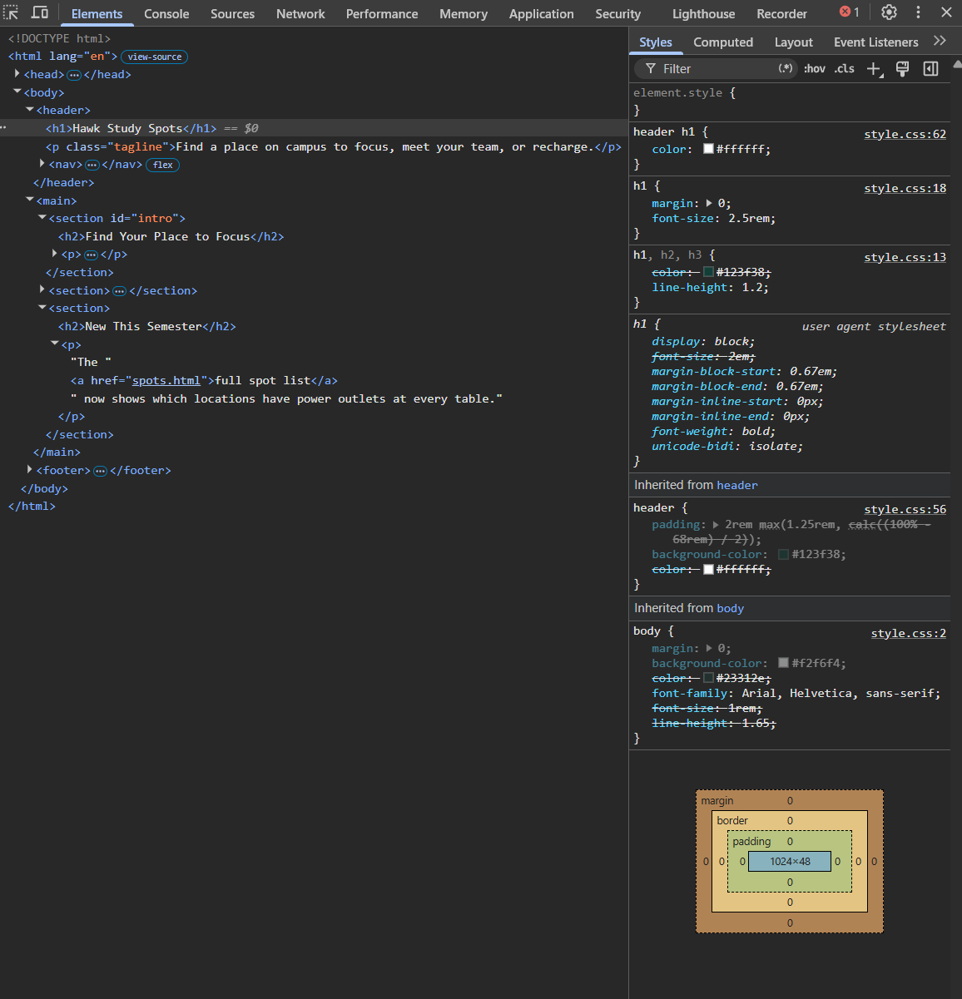
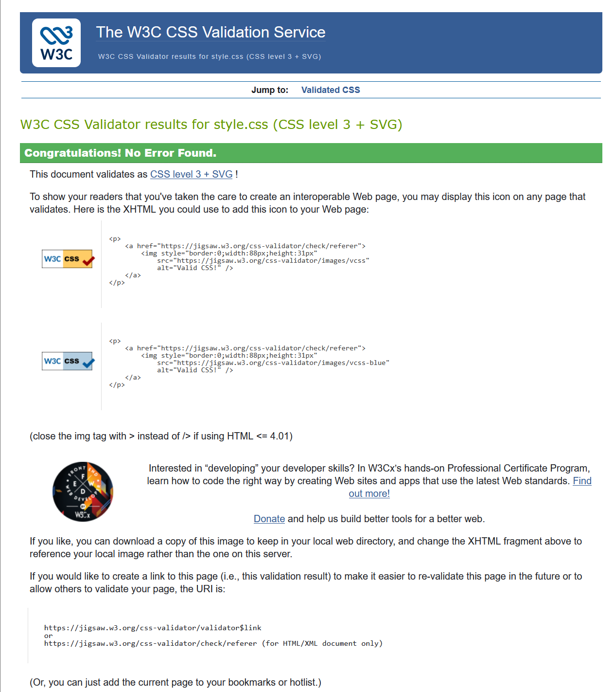

# PA1 – Styled Website · David Janney (@drjanney-ai)

CSDP 232 · Internet Programming · Fall 2026

## About this site

- Site styled: the supplied Hawk Study Spots site
- Pages: `index.html`, `spots.html`, `tips.html`
- How to view: open index.html in a browser to view the site.
  
## Color and contrast check

| Text | Text color | Background color | Contrast ratio (from DevTools) |
|---|---|---|---|
| Body text | `#23312e` | `#f2f6f4` | 13.54:1 |
| Link text | `#123f38` | `#f2f6f4` | 10.73:1 |

Both the body text and link text meet the required 4.5:1 contrast ratio for normal text.

## Cascade log

### 1. Two rules, one element

The header `<h1>` is affected by two rules that both set the color.
The `h1, h2, h3` selector has a specificity of 0-0-1. The `header h1` selector has a specificity of 0-0-2.
The `header h1` rule wins because it has higher specificity, so the heading is white.

### 2. Inheritance

The `color` property is inherited from a parent element. This means child elements can get the same text color from their parent.
The `margin` property is not inherited. A child does not automatically get the parent's margin.
DevTools shows inherited properties under the "Inherited from" section.

### 3. DevTools evidence
The screenshot shows the header `<h1>` in DevTools. The `header h1` rule is being used, while the other color rule is crossed out because it loses in the cascade.

## Validation
The CSS was checked with the W3C CSS Validator and had 0 errors.

All three HTML pages were also checked with the W3C Markup Validation Service. They had no errors or warnings.

## AI use statement
I used ChatGPT to help me understand the assignment, explain CSS concepts, check my work, and organize parts of this README. I used AI as a guide rather than having it write the code.
